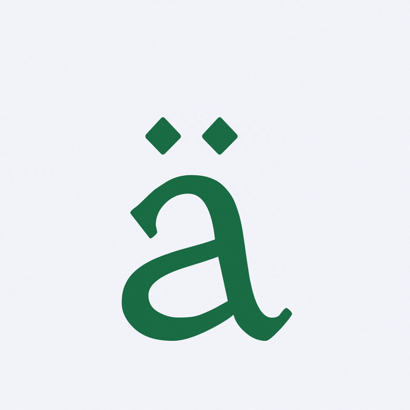

atwodots is a community of developers building open-source projects, primarily focused on systems programming, reverse engineering, runtimes, and cybersecurity.

We encourage people to understand, explore, and reflect on the systems they use rather than simply accept them as they are. We are always open to collaboration and knowledge sharing.

We welcome developers, enthusiasts, and anyone who shares our values. Whether you want to contribute, exchange ideas, or collaborate on projects, you are always welcome at atwodots.

  

